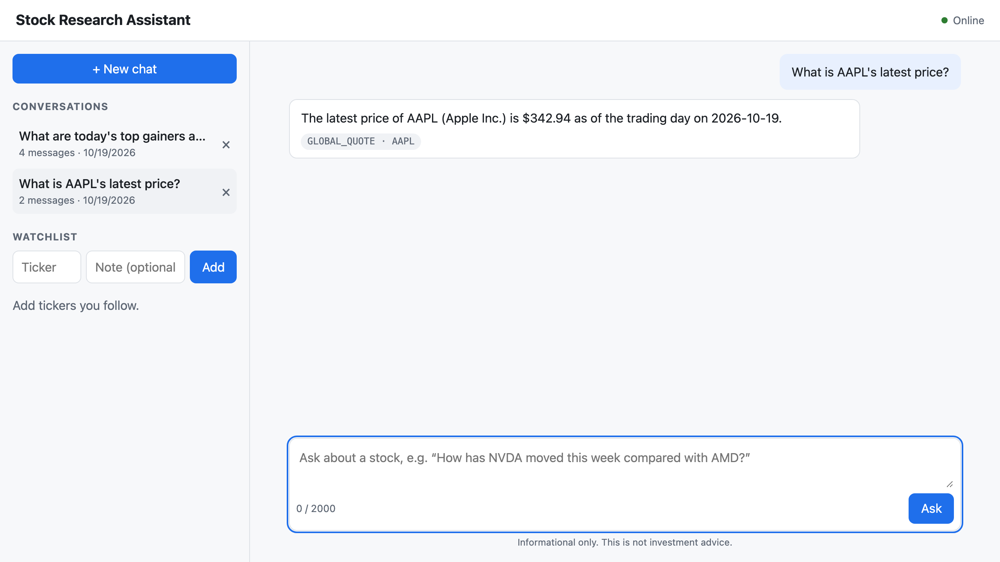
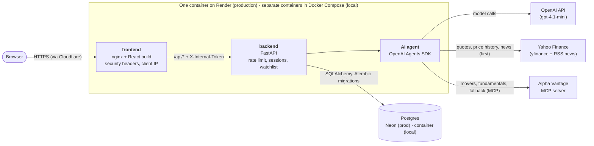
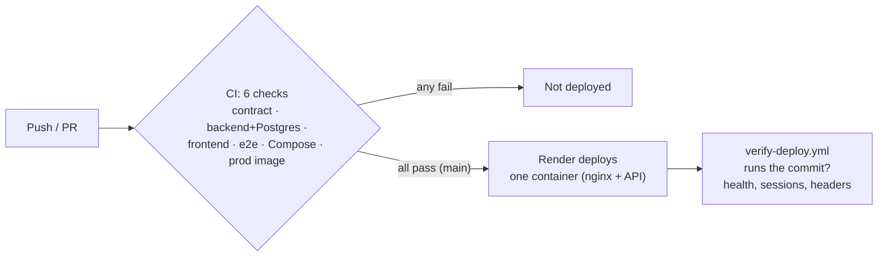

# Stock Research Assistant

[](https://github.com/Crooked-Cat-Tail-Software/stock-assistant/actions/workflows/ci.yml)

**Live:** <https://stock-assistant-web.onrender.com>. It's on Render's free tier,
so the first request after 15 idle minutes takes about a minute to wake up.

Ask market questions in plain English and get answers backed by **live market
data** from Yahoo Finance and Alpha Vantage. An AI agent decides which market-data tools to call, shows
which ones it used, and saves the conversation so you can return to it. A
personal watchlist lets you start research on a ticker in one click.



> Final project for [AI Dev Tools Zoomcamp](https://github.com/DataTalksClub/ai-dev-tools-zoomcamp)
> (2026 cohort). Built with AI coding agents. See [How it was built](#how-it-was-built).

## The problem

A quick read on a stock usually means jumping between quote sites, charting
tools, and news, then putting the answer together yourself. Questions like
*"How has NVDA moved this week compared with AMD?"* or *"What were today's top
gainers?"* take several lookups and some manual comparison.

## What it does

| | Feature | Expected behavior |
|---|---|---|
| F1 | **Ask a question** | The agent picks market-data tools: **Yahoo Finance** for quotes, price history (yfinance), and news (RSS headlines), and **Alpha Vantage** (over MCP) for top movers and fundamentals, and as the fallback if Yahoo fails. Replies usually take under 30 s and show which tools were used (e.g. `get_quote · AAPL`). |
| F2 | **Conversation history** | Every chat is saved and listed newest first. Reopening one restores the full history, and follow-ups use the earlier turns as context. |
| F3 | **Delete a conversation** | After you confirm, it's removed along with its messages. |
| F4 | **Watchlist** | Add tickers (stored uppercase, e.g. `brk.b` → `BRK.B`) with an optional note. Duplicates are rejected. |
| F5 | **Ask about a ticker** | "Ask" next to a watchlist ticker opens a new chat with a prefilled question. Nothing is sent until you click Ask. |
| F6 | **Health check** | `GET /api/health` reports the API, the database, and the deployed commit. |

**Guardrails:** questions are capped at 2,000 characters. Each visitor gets
10 questions a minute, which caps OpenAI spend. The agent can use **only**
read-only market-data tools (no file or shell access).
Yahoo data is cached briefly, and Alpha Vantage's ~25 free requests a day are
kept for what Yahoo can't provide. API keys never reach the
browser or the logs. Answers are informational, not investment advice.

The full specification, with acceptance criteria, is in
[product-spec.md](product-spec.md). Work is tracked in
[GitHub Issues](https://github.com/Crooked-Cat-Tail-Software/stock-assistant/issues).

## Architecture



| Component | Technology | Role |
|-----------|------------|------|
| **Frontend** | React 19, Vite, TypeScript, nginx | Chat, history, and watchlist UI. All API calls go through one typed client generated from [`openapi.yaml`](openapi.yaml). nginx serves the app, forwards `/api`, sets CSP and other security headers, and passes on the real client IP. |
| **Backend** | Python 3.13, FastAPI, SQLAlchemy, Alembic | Implements the [API contract](openapi.yaml): sessions, messages, watchlist, health. Enforces the rate limit and the question-length limit. Rejects requests that don't come through nginx. |
| **AI agent** | OpenAI Agents SDK, [yfinance](https://github.com/ranaroussi/yfinance) tools, [Alpha Vantage MCP](https://github.com/alphavantage/alpha_vantage_mcp) | Answers questions by calling market-data tools: Yahoo for quotes, price history, and news (cached, with timeouts; news parsed safely with `defusedxml`), Alpha Vantage for movers, fundamentals, and fallback. Tool output is treated as data, never as instructions. Adapted from the Alpha Vantage agent example, with the filesystem server removed and tracing off. A `FakeAgent` replaces it in tests and keyless demos. |
| **Database** | Postgres 17 (Neon in production), SQLite for quick dev | Conversations, messages, and watchlist. The schema is managed by Alembic migrations. |
| **Containers** | Docker, Docker Compose | One command runs the full stack locally. Same images as production. Non-root, with health checks. |
| **CI** | GitHub Actions | Contract check, backend (unit + integration on Postgres), frontend, end-to-end (Playwright), Docker Compose smoke test, and production-image smoke test on every push and PR. |
| **CD** | Render (`checksPass`) + GitHub Actions | Render deploys `main` only after all CI checks pass, then [`verify-deploy.yml`](.github/workflows/verify-deploy.yml) confirms the live site runs that commit. |

More detail: [docs/deployment.md](docs/deployment.md) (CD flow, security
model, how the client IP is found on Render) and [docs/testing.md](docs/testing.md).

## Run it locally

You need [Docker](https://docs.docker.com/get-docker/). One command starts
everything, including the database:

```bash
git clone https://github.com/Crooked-Cat-Tail-Software/stock-assistant.git
cd stock-assistant
docker compose up --build        # then open http://localhost:8080
```

With no `.env` file the app uses a **fake agent**: no API keys and no cost. It
answers with sample data, so you can try every feature. For real answers:

```bash
cp .env.example .env             # then set AGENT_MODE=openai, OPENAI_API_KEY, ALPHAVANTAGE_API_KEY
docker compose up -d             # restart with the keys
```

Quotes, price history, and news come from Yahoo Finance and need no key. A
free Alpha Vantage key (<https://www.alphavantage.co/support/#api-key>, about
25 requests a day) is still needed for top movers, fundamentals, and the
fallback.

| Service | What it does |
|---------|--------------|
| `db` | Postgres 17. Data lives in the `db-data` volume and survives restarts. Published on `127.0.0.1:5432` only. |
| `backend` | FastAPI. Applies migrations on startup. Not published: reachable only through `frontend`. |
| `frontend` | nginx serving the React app on port 8080 and forwarding `/api` to `backend`. |

`make up` / `make down` do the same as `docker compose up --build -d --wait` and
`docker compose down`. `docker compose down -v` also deletes the database.

<details>
<summary>Without Docker (for development)</summary>

Needs [uv](https://docs.astral.sh/uv/) and Node 24. Start the backend in one
terminal:

```bash
cd backend
uv sync
uv run alembic upgrade head                                 # creates backend/dev.db (SQLite)
uv run uvicorn app.main:create_app --factory --reload       # http://localhost:8000/docs
```

Then the frontend in a second terminal:

```bash
cd frontend
npm ci
npm run dev                                                 # http://localhost:5173
```

Vite forwards `/api` to the backend on port 8000, so no CORS setup is needed.
</details>

## Tests

**One command runs every unit and integration test**, backend and frontend. It
needs no API keys, Docker, or running services:

```bash
make install     # first time only (uv sync + npm ci)
make test        # backend unit + integration, frontend unit tests
make test-all    # + Playwright end-to-end (once: cd frontend && npx playwright install chromium)
```

| Layer | Where | What it proves |
|-------|-------|----------------|
| Backend unit | `backend/tests/unit/` | Business rules, the rate limiter, URL handling, API keys never logged |
| Backend integration | `backend/tests/integration/` | Real HTTP and a real database built by migrations. **Every response is validated against `openapi.yaml`.** Runs on Postgres in CI. |
| Frontend unit | `frontend/src/**/*.test.ts(x)` | API client, validation (checked against the contract), UI flows |
| End-to-end | `frontend/e2e/` | The production build in a real browser against the real backend, covering every feature |

No test calls OpenAI, Alpha Vantage, or Yahoo. Coverage is about 97% (backend) and
93% (frontend). Details, and a map from each feature to its tests:
[docs/testing.md](docs/testing.md).

## Deployment and CI/CD



- **Production:** <https://stock-assistant-web.onrender.com>, **one** Docker web
  service from [`render.yaml`](render.yaml) and the root [`Dockerfile`](Dockerfile)
  (nginx and the API in one container), with the database on Neon. It started
  as two services, but on Render's free plan a sleeping API couldn't be woken by
  the web service, so they were merged
  ([why](docs/deployment.md#why-one-service-issue-24)).
- **Deploy gate:** Render's `autoDeployTrigger: checksPass` deploys a commit
  only when every CI check on it passed. A failing commit never reaches users.
- **Rollback:** revert the bad commit on `main`. The revert goes through the
  same CI gate and deploys automatically. In an emergency, Render's dashboard
  can redeploy an earlier successful deploy directly.
- **Known gap:** changes to `render.yaml` are applied by Render's Blueprint
  sync without waiting for CI, so they're committed on their own
  ([details](docs/deployment.md#known-gap-renderyaml-changes-skip-the-ci-gate)).

Setup steps, the security model, and troubleshooting are in [docs/deployment.md](docs/deployment.md).

## How it was built

This project was built by the author working with **Claude Code** as the lead
coding agent, with specialist subagents for contract review, tests, security,
and deploy verification.

| Document | What it covers |
|----------|----------------|
| [AGENTS.md](AGENTS.md) | Entry point for AI agents: rules, and which doc to read for each task |
| [docs/agent-team.md](docs/agent-team.md) | Roles (human, lead agent, four subagents, CI, Render), their limits, and hand-offs |
| [docs/process.md](docs/process.md) | Issue → plan → branch → review → PR → deploy → verify, plus the definition of done |
| [docs/ai-workflow.md](docs/ai-workflow.md) | Log of each phase: what was asked, what the AI did, problems it caught, how it was verified |
| [GitHub Issues](https://github.com/Crooked-Cat-Tail-Software/stock-assistant/issues) | Task tracker. Each issue has acceptance criteria, the agent's plan comment, and links to commits and PRs |

## Course criteria

Where each of the [2026 project criteria](https://github.com/DataTalksClub/ai-dev-tools-zoomcamp/tree/main/project)
is addressed:

| Criterion | Where to look | Status |
|-----------|---------------|--------|
| Problem description | This README: [The problem](#the-problem), [What it does](#what-it-does) | ✅ |
| Product specification | [product-spec.md](product-spec.md), plus the [public tracker](https://github.com/Crooked-Cat-Tail-Software/stock-assistant/issues?q=is%3Aissue) with acceptance criteria. Agent plan comments on [#1](https://github.com/Crooked-Cat-Tail-Software/stock-assistant/issues/1)–[#4](https://github.com/Crooked-Cat-Tail-Software/stock-assistant/issues/4); [PR #14](https://github.com/Crooked-Cat-Tail-Software/stock-assistant/pull/14) closed #1–#3 | ✅ |
| Agent team specification | [docs/agent-team.md](docs/agent-team.md), [`.claude/agents/`](.claude/agents/) | ✅ |
| Context management | [AGENTS.md](AGENTS.md) routes to modular docs ([process](docs/process.md), [team](docs/agent-team.md), [testing](docs/testing.md), [deployment](docs/deployment.md)) | ✅ |
| Application | Full stack, end to end: React → FastAPI → Postgres. `docker compose up --build` | ✅ |
| Testing | Unit + integration (+ e2e), all with `make test` | ✅ |
| Containerization | [docker-compose.yml](docker-compose.yml): database, backend, frontend, one command | ✅ |
| Deployment | <https://stock-assistant-web.onrender.com> | ✅ |
| CI/CD | [ci.yml](.github/workflows/ci.yml) + Render `checksPass` + [verify-deploy.yml](.github/workflows/verify-deploy.yml). There's a single production environment (no separate dev stage) | ✅ (CI + CD) |
| Observability | Plain application logs only: no metrics, traces, or shared trace IDs | ⚠️ partial |
| Alerting on user impact | Not implemented | ❌ |
| On-call agent | Not implemented | ❌ |

## Credits

The agent code is adapted from the MIT-licensed
[Alpha Vantage MCP agent example](https://github.com/alphavantage/alpha_vantage_mcp/tree/main/examples/agent).
See [THIRD_PARTY_NOTICES.md](THIRD_PARTY_NOTICES.md).

Quotes and price history use [yfinance](https://github.com/ranaroussi/yfinance)
(Apache-2.0), an unofficial library that reads Yahoo Finance data, and news
uses Yahoo Finance's RSS headline feed. Yahoo
intends that data for personal and educational use, which fits this class
project. A commercial version would need a licensed data provider.
